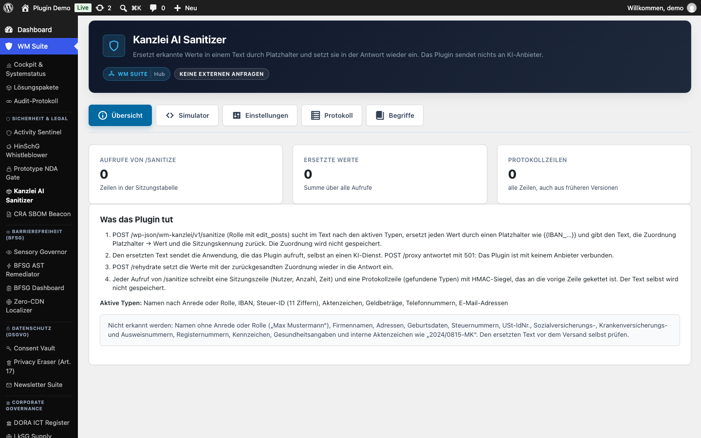
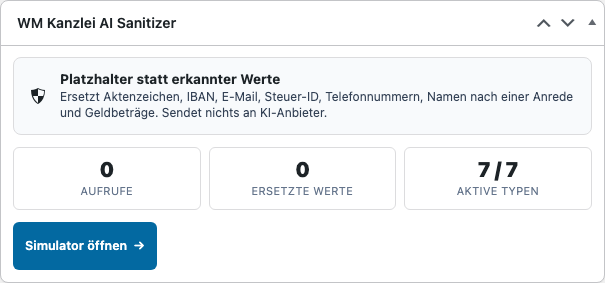

# WM Kanzlei AI Sanitizer (Deutsche Dokumentation)

  
  
  

  

> **Ersetzt Aktenzeichen, IBAN, E-Mail-Adressen, Steuer-IDs, Telefonnummern, Namen nach einer Anrede und Geldbeträge in einem Text durch Platzhalter und setzt die Werte in der Antwort wieder ein — über REST-Routen, WP-CLI und einen Simulator im Backend, mit einem HMAC-verketteten Protokoll der Aufrufe. Das Plugin sendet nichts an KI-Anbieter.**  
> **Plugin-Seite:** [https://arnoldwender.com/wordpress-plugins/wm-kanzlei-ai-sanitizer/](https://arnoldwender.com/wordpress-plugins/wm-kanzlei-ai-sanitizer/)  
> **Mit einem agentischen Workflow entwickelt:** entstanden mit KI-Coding-Agenten. Prüfen und testen Sie es wie jeden fremden Code, bevor Sie es produktiv einsetzen.  
> **Support & Haftung:** Kein Support (Zero Support) — reproduzierbare Bugs ausschließlich über [GitHub Issues](https://github.com/arnoldwender/wm-wp-kanzlei-ai-sanitizer/issues) · kein privater Support · OHNE GEWÄHR („AS IS“) / keine Haftung ([SUPPORT.md](SUPPORT.md))

> Bis zum 2026-09-15 beschrieben diese Dokumentation und das Plugin einen „§ 203 StGB & § 43e BRAO konformen“ „Zero-Knowledge-Proxy“ mit „PII Surrogate Vault“, „Merkle-gehashtem“ Prüfprotokoll und Abfangen jedes LLM-Prompts für „Kanzleien, Steuer- und Arztpraxen“. Am Code gemessen: Es gibt keine Anfrage an einen KI-Anbieter, `/proxy` lieferte ein festes Rechtsgutachten, `/certificate` stellte Bescheinigungen für nie vorhandene Sitzungen aus, nichts wurde in einem Tresor gespeichert, die Hashes des Protokolls waren nicht verkettet, und die Erkennung übersah übliche Namen, Beträge und Aktenzeichen. Diese Datei beschreibt, was das Plugin jetzt tut.

---

## Live-Vorschau

!WM Kanzlei AI Sanitizer Banner

| Übersicht | Dashboard-Widget |
|---|---|
|  |  |

---

## Was das Plugin leistet

1. **Erkennung:** `NerEngine::detect_entities()` findet mit regulären Ausdrücken sieben Typen: Aktenzeichen (Kammer als Zahl oder römische Ziffer, Register mit 1-4 Buchstaben, Nummer/Jahr: `2 O 145/23`, `VI ZR 244/20`, `1 BvR 102/22`), IBAN (beliebige Schreibweise, mit Leerzeichen oder Bindestrichen, gekürzt auf das längste Stück, das die Prüfziffer nach ISO 7064 Mod 97 besteht), E-Mail-Adressen, 11-stellige Steuer-IDs (führende Ziffer `1–9` nach § 139b AO und Mod-11,10-Prüfung über `steuer_id_checksum_ok()`), deutsche Telefonnummern (`+49 345 …`, `+49 (0)345 …`, `0345/…`, `0176…`), Namen nach Anrede oder Rolle (`Herr`, `Herrn`, `Frau`, `Rechtsanwältin`, `Mandantin`, `dem Beklagten`, `Kläger`, `Patientin`, `Dr.`, `Prof.`, mit akademischen Titeln, `von`/`zu` und bis zu drei Namenswörtern mit Bindestrich, sowie derselbe Nachname, wo er später allein steht) und Geldbeträge mit Währung davor oder dahinter (`50.000,00 €`, `EUR 3.200,00`, `5000 EUR`). `NerEngine::collect_review_warnings()` meldet nicht bestätigte Steuer-IDs (`steuer_id_unverified_checksum`, weiterhin als `STEUER_ID` ersetzt) sowie unmittelbar folgende großgeschriebene Wörter nach einem Namen (`possible_trailing_name_word`). Text, der kein gültiges UTF-8 ist, wird abgewiesen statt nur teilweise geprüft.
2. **Platzhalter:** `TokenVault::tokenize()` ersetzt jeden Wert durch `{{TYP_<16 Hex>}}`, einen HMAC des Werts mit einem Zufallsschlüssel je Aufruf, und liefert Text und Zuordnung Platzhalter → Wert. Die Zuordnung wird nirgends gespeichert; `rehydrate()` setzt die Werte mit der Zuordnung ein, die der Aufrufer zurückschickt.
3. **REST** (`wm-kanzlei/v1`): `POST /sanitize` (`edit_posts`) ersetzt die aktiven Typen, schreibt eine Sitzungs- und eine versiegelte Protokollzeile und liefert Text, Zuordnung, `review_warnings` und Sitzungskennung; 400 bei ungültigem UTF-8, 503 ohne Text, wenn die Protokollzeile nicht geschrieben werden kann. `POST /rehydrate` (`edit_posts`): 400 bei einer Zuordnung, die nicht aus Platzhaltern und Texten besteht. `POST /proxy`: 501, kein Anbieter angebunden. `GET /certificate?session_id=` (Administratoren oder der Nutzer der Sitzung): was die Datenbank über eine Sitzung weiß, samt Kettenstatus, 404 bei unbekannter Sitzung; keine Konformitätsbescheinigung. `GET /audit-log` (`manage_options`): die neuesten 50 Zeilen, Gesamtzahl und Kettenprüfung.
4. **Protokoll:** Jeder Aufruf von `/sanitize` ergänzt eine Zeile (Sitzung, gefundene Typen, Zeit), deren Siegel ein HMAC mit `wp_salt( 'secure_auth' )` über das Siegel der vorigen Zeile und den Zeileninhalt ist; das neueste Siegel steht zusätzlich in der Option `wm_kanzlei_audit_chain_tip`, Anhängen braucht eine MySQL-Sperre. Die Prüfung meldet `INTACT`, `EMPTY_CHAIN`, `UNCHAINED_ONLY` (nur Zeilen aus der Zeit vor der Kette) oder `BROKEN` mit Grund. Das Protokoll hält fest, dass ersetzt wurde, nicht den Text und nicht, ob oder wohin er gesendet wurde.
5. **Einstellungen:** Sieben Schalter (Option `wm_kanzlei_settings`) bestimmen, welche Typen REST, WP-CLI und Simulator ersetzen; ein fehlender Schalter gilt als an. Eine Opt-in-Option (`wm_kanzlei_delete_data_on_uninstall`, standardmäßig aus) steuert, ob die Deinstallation Optionen und Tabellen entfernt.
6. **Backend:** Menü *KI-Sanitizer* (`edit_posts`) mit *Übersicht* (Zahlen aus den Tabellen, was erkannt wird und was nicht), *Simulator* (speichert nichts), *Einstellungen* und *Protokoll* (`manage_options`), *Begriffe*; ein Dashboard-Widget.
7. **WP-CLI:** `wp kanzlei sanitize "<Text>"` zeigt die geprüften Typen, die gefundenen Werte maskiert und den ersetzten Text.
8. **WM Suite Hub Spoke:** Zustand `ERROR` ohne Tabellen, bei gebrochener Kette oder gescheitertem Erkennungstest; Aktionen `self_test` und `verify_chain`.
9. **Erweiterbarkeit & Block Bindings:** WP 6.5+ Block Bindings (`wm-kanzlei/stats`), GenerateBlocks 2.x Dynamic Tag (`{{wm_kanzlei_stat}}`), Filter (`wm_kanzlei_entity_patterns`, `wm_kanzlei_sanitized_result`, `wm_kanzlei_stat_value`) und Action (`wm_kanzlei_ready`).

### Nicht enthalten

Keine Verbindung zu einem KI-Anbieter; keine Speicherung von Zuordnung oder Text; keine Verschlüsselung; kein automatischer Ablauf der Sitzungs- und Protokollzeilen (sie bleiben bei der Deinstallation erhalten, sofern das Löschen nicht ausdrücklich eingeschaltet wird); keine Erkennung von Namen ohne Anrede, Firmennamen, Adressen, Geburtsdaten, Steuernummern, USt-IdNr., Sozialversicherungs-, Krankenversicherungs- und Ausweisnummern, Registernummern, Kennzeichen, Gesundheitsangaben oder internen Aktenzeichen wie `2024/0815-MK`; keine Drosselung; keine Beurteilung, ob ein Text an einen Dienstleister gehen darf.

---

## Schnellstart

1. Plugin installieren und aktivieren (WordPress 6.4+, PHP 8.2+). Die Aktivierung legt die Tabellen `wp_wm_kanzlei_sessions` und `wp_wm_kanzlei_audit_log` an.
2. **KI-Sanitizer › Simulator** öffnen, den Beispieltext laden und ansehen, was ersetzt wird und was nicht.
3. Aus der eigenen Anwendung: `POST /wp-json/wm-kanzlei/v1/sanitize {"prompt": "…"}`, `sanitized_text` an den gewählten KI-Dienst senden, dann `POST /wp-json/wm-kanzlei/v1/rehydrate {"response": "…", "mapping": {…}}`.
4. Auf dem Server: `wp kanzlei sanitize "Im Rechtsstreit 2 O 145/23 überweisen Sie das Honorar an DE89370400440532013000."`

Klassen, Routen und bekannte Grenzen im Detail: **[README.md](README.md)** (Referenz), **[DEVELOPERS.md](DEVELOPERS.md)**, **[docs/LEGAL-COMPLIANCE.md](docs/LEGAL-COMPLIANCE.md)**.

---

## Bekannte Grenzen

- Die Erkennung ist eine Sammlung von Mustern. Sie verringert, was ein Modell erreicht; sie macht einen Text nicht frei von personenbezogenen Daten.
- Platzhalter sind Pseudonymisierung (Art. 4 Nr. 5 DSGVO): Wer die Zuordnung hat, stellt die Werte wieder her; nicht erkannte Werte bleiben im Klartext.
- Das Protokoll macht Änderungen erkennbar, ersetzt aber keinen externen Schreibschutz: Wer `wp-config.php` hat, kann die Kette neu versiegeln; eine auf eine Website mit anderen Salts kopierte Datenbank prüft als `BROKEN`.
- Installationen mit einer früheren Version behalten ihre unversiegelten Zeilen (auf einer lokalen WordPress-Installation und der Demo-Box acht erfundene Beispielzeilen, zwei davon mit „Dr. Hans Schmidt“); sie zählen als unverkettet. Löschen wartet auf Arnold.
- Die Deinstallation behält Optionen und beide Tabellen standardmäßig bei; gelöscht werden sie nur, wenn `wm_kanzlei_delete_data_on_uninstall` in den Einstellungen ausdrücklich eingeschaltet wurde.

---

## Konformität

- **Keine ausgehenden Anfragen:** Das Plugin sendet keinen Text; was die aufrufende Anwendung an wen sendet, entscheidet sie.
- **Gespeicherte Daten:** je Aufruf eine Sitzungszeile (Nutzerkennung, Anzahl der Werte, geschätzte Länge, Zeit) und eine Protokollzeile (gefundene Typen, Zeit, Siegel); kein Text, keine Zuordnung.
- **Reichweite:** Ob und unter welchen Bedingungen ein Text an einen Dienstleister gehen darf (§ 203 StGB, § 43e BRAO, DSGVO), entscheidet das Plugin nicht, und nichts, was es liefert, bescheinigt es.

---

## Lizenz

Veröffentlicht unter der **GNU General Public License v2 or later** (`GPL-2.0-or-later`). Siehe [LICENSE](LICENSE) oder [https://www.gnu.org/licenses/gpl-2.0.html](https://www.gnu.org/licenses/gpl-2.0.html).  
