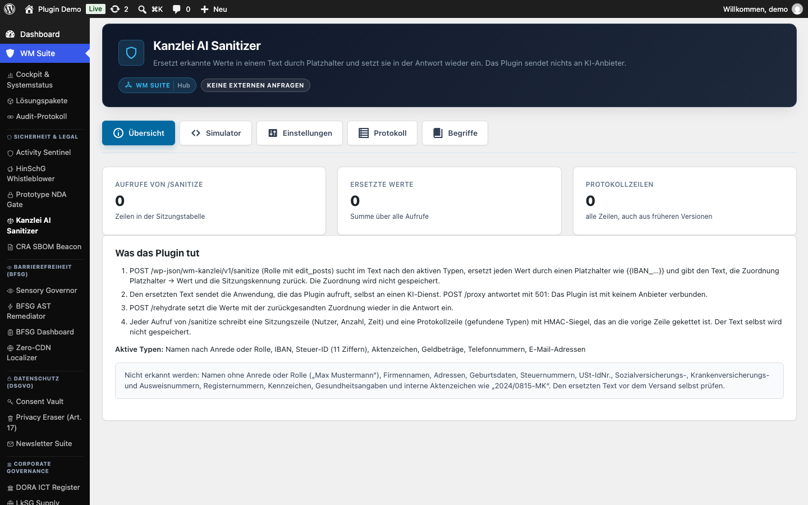
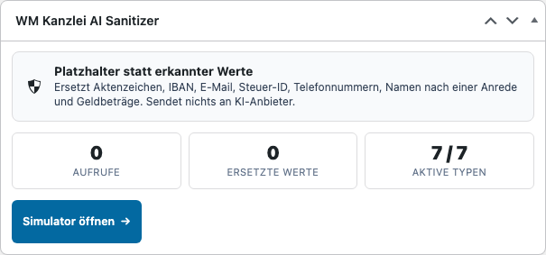

# WM Kanzlei AI Sanitizer (Documentación en Español)

  
  
  

  

> **Sustituye números de expediente judicial alemanes, IBAN, correos, Steuer-ID, teléfonos, nombres precedidos de un tratamiento e importes por marcadores en un texto y devuelve los valores a la respuesta — por rutas REST, WP-CLI y un simulador en el panel, con un registro de las llamadas encadenado por HMAC. No envía nada a proveedores de IA.**  
> **Página del plugin:** [https://arnoldwender.com/es/plugins-wordpress/wm-kanzlei-ai-sanitizer/](https://arnoldwender.com/es/plugins-wordpress/wm-kanzlei-ai-sanitizer/)  
> **Desarrollado con un agentic workflow:** creado con agentes de programación de IA. Revísalo y pruébalo como cualquier código de terceros antes de usarlo en producción.  
> **Soporte y responsabilidad:** Cero soporte (Zero Support) — errores reproducibles únicamente en [GitHub Issues](https://github.com/arnoldwender/wm-wp-kanzlei-ai-sanitizer/issues) · sin soporte privado · TAL CUAL («AS IS») / sin responsabilidad ([SUPPORT.md](SUPPORT.md))

> Hasta el 2026-09-15 esta documentación y el plugin describían un «proxy zero-knowledge» «conforme al § 203 StGB y § 43e BRAO» con «bóveda de sustitutos», registro «Merkle» e interceptación de todos los prompts para «despachos, asesorías y consultorios». Medido contra el código: no existe ninguna petición a un proveedor de IA, `/proxy` devolvía un dictamen jurídico fijo, `/certificate` emitía certificados para sesiones inexistentes, nada se guardaba en una bóveda, los hashes del registro no estaban encadenados y la detección no veía nombres, importes ni expedientes habituales. Este archivo describe lo que hace ahora.

---

## Capturas en vivo

!Banner de WM Kanzlei AI Sanitizer

| Resumen | Widget del escritorio |
|---|---|
|  |  |

---

## Qué hace el plugin

1. **Detección:** `NerEngine::detect_entities()` encuentra con expresiones regulares siete tipos: expedientes judiciales (sala en cifras o número romano, registro de 1-4 letras, número/año: `2 O 145/23`, `VI ZR 244/20`, `1 BvR 102/22`), IBAN (en mayúsculas o minúsculas, con espacios o guiones, recortado al tramo más largo que pasa el control ISO 7064 mod 97), correos, Steuer-ID de 11 cifras (primer dígito `1–9` según § 139b AO y validación oficial BZSt Mod 11,10 mediante `steuer_id_checksum_ok()`), teléfonos alemanes (`+49 345 …`, `+49 (0)345 …`, `0345/…`, `0176…`), nombres después de un tratamiento o rol (`Herr`, `Herrn`, `Frau`, `Rechtsanwältin`, `Mandantin`, `dem Beklagten`, `Kläger`, `Patientin`, `Dr.`, `Prof.`, con títulos, `von`/`zu` y hasta tres palabras con guion, y el mismo apellido cuando aparece solo más adelante) e importes con la moneda antes o después (`50.000,00 €`, `EUR 3.200,00`, `5000 EUR`). `NerEngine::collect_review_warnings()` señala candidatos a Steuer-ID sin dígito de control confirmado (`steuer_id_unverified_checksum`, sustituidos igualmente por seguridad) y palabras en mayúscula sin sustituir tras un nombre (`possible_trailing_name_word`). Un texto que no es UTF-8 válido se rechaza en lugar de revisarse a medias.
2. **Marcadores:** `TokenVault::tokenize()` sustituye cada valor por `{{TIPO_<16 hex>}}`, un HMAC del valor con una clave aleatoria por llamada, y devuelve el texto y el mapa marcador → valor. El mapa no se guarda; `rehydrate()` repone los valores con el mapa que envía quien llama.
3. **REST** (`wm-kanzlei/v1`): `POST /sanitize` (`edit_posts`) sustituye los tipos activos, escribe una fila de sesión y una fila sellada en el registro y devuelve texto, mapa, `review_warnings` e id de sesión; 400 con UTF-8 inválido, 503 sin texto si la fila del registro no se puede escribir. `POST /rehydrate` (`edit_posts`): 400 si el mapa no es de marcadores a textos. `POST /proxy`: 501, sin proveedor. `GET /certificate?session_id=` (administradores o quien hizo la sesión): lo que la base de datos guarda de una sesión y el estado de la cadena, 404 si no existe; no es un certificado de conformidad. `GET /audit-log` (`manage_options`): las 50 filas más recientes, el total y la verificación.
4. **Registro:** cada llamada a `/sanitize` agrega una fila (sesión, tipos encontrados, hora) cuyo sello es un HMAC con `wp_salt( 'secure_auth' )` sobre el sello anterior y el contenido; el sello más reciente se refleja en la opción `wm_kanzlei_audit_chain_tip` y cada anexo toma un bloqueo de MySQL. La verificación informa `INTACT`, `EMPTY_CHAIN`, `UNCHAINED_ONLY` (solo filas anteriores a la cadena) o `BROKEN` con el motivo. El registro deja constancia de que se sustituyó, no del texto ni de si se envió o a dónde.
5. **Ajustes:** siete interruptores (opción `wm_kanzlei_settings`) deciden qué tipos sustituyen REST, WP-CLI y el simulador; un interruptor ausente cuenta como encendido. Una opción explícita (`wm_kanzlei_delete_data_on_uninstall`, desactivada por defecto) controla si al desinstalar se borran las opciones y tablas.
6. **Panel:** menú *KI-Sanitizer* (`edit_posts`) en alemán con *Übersicht*, *Simulator* (no guarda nada), *Einstellungen* y *Protokoll* (`manage_options`) y *Begriffe*; un widget en el escritorio.
7. **WP-CLI:** `wp kanzlei sanitize "<texto>"` muestra los tipos revisados, los valores encontrados enmascarados y el texto sustituido.
8. **Spoke del WM Suite Hub:** estado `ERROR` sin tablas, con la cadena rota o con la autoprueba de detección fallida; acciones `self_test` y `verify_chain`.
9. **Extensibilidad y Block Bindings:** WP 6.5+ Block Bindings (`wm-kanzlei/stats`), Dynamic Tag de GenerateBlocks 2.x (`{{wm_kanzlei_stat}}`), filtros (`wm_kanzlei_entity_patterns`, `wm_kanzlei_sanitized_result`, `wm_kanzlei_stat_value`) y acción (`wm_kanzlei_ready`).

### No incluido

Ninguna conexión a proveedores de IA; no se guarda ni el mapa ni el texto; sin cifrado; sin vencimiento automático de las filas de sesión y registro (se conservan al desinstalar salvo activación expresa de borrado); no detecta nombres sin tratamiento, nombres de empresa, direcciones, fechas de nacimiento, Steuernummer, USt-IdNr, números de seguridad social, seguro médico o identificación, registros mercantiles, matrículas, datos de salud ni referencias internas como `2024/0815-MK`; sin límite de peticiones; no evalúa si un texto puede entregarse a un prestador de servicios.

---

## Inicio rápido

1. Instala y activa el plugin (WordPress 6.4+, PHP 8.2+). La activación crea las tablas `wp_wm_kanzlei_sessions` y `wp_wm_kanzlei_audit_log`.
2. Abre **KI-Sanitizer › Simulator**, carga el texto de ejemplo y revisa qué se sustituye y qué no.
3. Desde tu aplicación: `POST /wp-json/wm-kanzlei/v1/sanitize {"prompt": "…"}`, envía `sanitized_text` al servicio de IA que elijas y luego `POST /wp-json/wm-kanzlei/v1/rehydrate {"response": "…", "mapping": {…}}`.
4. En el servidor: `wp kanzlei sanitize "Im Rechtsstreit 2 O 145/23 überweisen Sie das Honorar an DE89370400440532013000."`

Clases, rutas y limitaciones en detalle: **[README.md](README.md)** (referencia), **[DEVELOPERS.md](DEVELOPERS.md)**, **[docs/LEGAL-COMPLIANCE.md](docs/LEGAL-COMPLIANCE.md)**.

---

## Limitaciones conocidas

- La detección es un conjunto de patrones: reduce lo que llega a un modelo; no deja un texto libre de datos personales.
- Los marcadores son seudonimización (Art. 4 Nr. 5 RGPD): quien tiene el mapa repone los valores; lo no detectado queda en claro.
- El registro permite detectar cambios, pero no sustituye a un medio de solo escritura: quien tiene `wp-config.php` puede volver a sellar la cadena; una base de datos copiada a un sitio con otras sales verifica como `BROKEN`.
- Las instalaciones con una versión anterior conservan sus filas sin sellar (en una instalación local de WordPress y la Box de demo, ocho filas de ejemplo inventadas, dos con «Dr. Hans Schmidt»); cuentan como no encadenadas. Borrarlas espera a Arnold.
- La desinstalación conserva las opciones y ambas tablas por defecto; solo se eliminan si `wm_kanzlei_delete_data_on_uninstall` se activa expresamente en los ajustes.

---

## Conformidad

- **Sin peticiones salientes:** el plugin no envía texto; qué envía la aplicación y a quién lo decide ella.
- **Datos guardados:** por llamada una fila de sesión (id de usuario, número de valores, longitud estimada, hora) y una fila de registro (tipos, hora, sello); ni texto ni mapa.
- **Alcance:** si un texto puede entregarse a un prestador de servicios y en qué condiciones (§ 203 StGB, § 43e BRAO, RGPD) no lo decide el plugin, y nada de lo que devuelve lo certifica.

---

## Licencia

Distribuido bajo la **GNU General Public License v2 or later** (`GPL-2.0-or-later`). Véase [LICENSE](LICENSE) o [https://www.gnu.org/licenses/gpl-2.0.html](https://www.gnu.org/licenses/gpl-2.0.html).  
