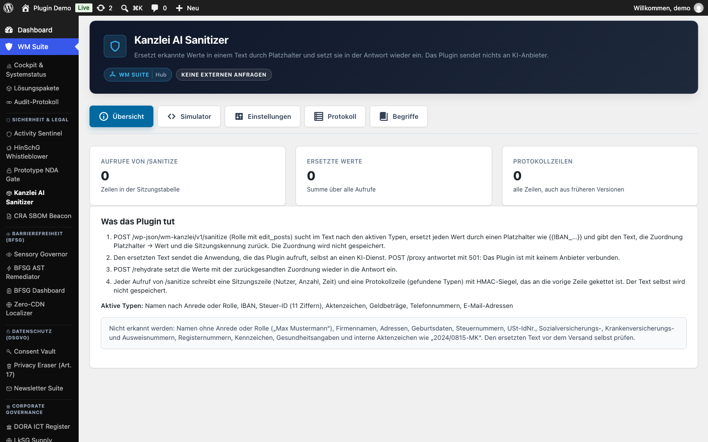
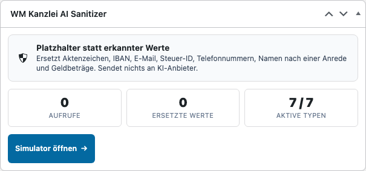

# WM Kanzlei AI Sanitizer

<p align="center">
  <a href="README.md"></a>
  <a href="README.de.md"></a>
  <a href="README.es.md"></a>
</p>

<p align="center">
  <a href="https://wordpress.org"></a>
  <a href="https://php.net"></a>
  
  <a href="https://www.gnu.org/licenses/gpl-2.0.html"></a>
</p>

> **Replaces court file numbers, IBANs, e-mail addresses, tax IDs, phone numbers, names after a title and amounts in a text with placeholders, and puts the values back into the answer — through REST routes, WP-CLI and an admin simulator, with an HMAC-chained log of the calls. It sends nothing to AI providers.**  
> **Plugin page:** [https://arnoldwender.com/wordpress-plugins/wm-kanzlei-ai-sanitizer/](https://arnoldwender.com/wordpress-plugins/wm-kanzlei-ai-sanitizer/)  
> **Built with an agentic workflow:** developed with AI coding agents. Review and test it like any third-party code before you use it in production.  
> **Support & Liability:** Zero support — reproducible bugs on [GitHub Issues](https://github.com/arnoldwender/wm-wp-kanzlei-ai-sanitizer/issues) only · no private support · AS IS / no liability ([SUPPORT.md](SUPPORT.md))

> Until 2026-09-15 this README and the plugin described a "§ 203 StGB & § 43e BRAO compliant" "zero-knowledge proxy" with a "PII surrogate vault", "Merkle-hashed" audit log and interception of every LLM prompt for "legal, tax and medical practices". Measured against the code: no request to any AI provider exists, `/proxy` returned a fixed legal opinion, `/certificate` issued certificates for sessions that never existed, nothing was stored in a vault, the log's hashes did not chain, and the detector missed common names, amounts and file numbers. This file describes what the plugin does now.

---

## Showcase

!WM Kanzlei AI Sanitizer banner

The banner above and the live WordPress screenshots below live in `.wordpress-org/`; the old marketing mockups were archived outside the repository on 2026-11-20 (release 1.2.0).

| Overview | Dashboard Widget |
|---|---|
|  |  |

---

## What the plugin does

1. **Detection.** `NerEngine::detect_entities( $text, $types )` finds, with regular expressions, seven types: court file numbers (chamber as digits or a Roman numeral, register of 1-4 letters, number/year: `2 O 145/23`, `VI ZR 244/20`, `1 BvR 102/22`), IBANs (any case, spaced or hyphenated, cut to the longest prefix that passes the ISO 7064 mod-97 check), e-mail addresses, 11-digit Steuer-IDs (non-zero leading digit `[1-9]\d`, with official BZSt § 139b AO / ISO 7064 Mod 11,10 validation in `steuer_id_checksum_ok()`), German phone numbers (`+49 345 …`, `+49 (0)345 …`, `0345/…`, `0176…`), names after a title or role (`Herr`, `Herrn`, `Frau`, `Rechtsanwältin`, `Mandantin`, `dem Beklagten`, `Kläger`, `Patientin`, `Dr.`, `Prof.`, with academic titles, `von`/`zu` and up to three hyphenated name words, and the same surname wherever it appears alone later), and amounts with the currency before or after (`50.000,00 €`, `EUR 3.200,00`, `5000 EUR`). `NerEngine::collect_review_warnings()` flags unverified `STEUER_ID` candidates (`steuer_id_unverified_checksum`, still redacted fail-safe) and unredacted capitalised trailing words after a `PERSON_NAME` (`possible_trailing_name_word`). Text that is not valid UTF-8 is refused instead of being checked partly.
2. **Placeholders.** `TokenVault::tokenize()` replaces each value with `{{TYPE_<16 hex>}}`, an HMAC of the value with a random key per call, and returns the text and the mapping placeholder → value. The mapping is not stored anywhere; `rehydrate()` puts the values back with the mapping the caller sends.
3. **REST** (namespace `wm-kanzlei/v1`):
   - `POST /sanitize` (`edit_posts`, `prompt`): replaces the enabled types, writes a session row and a sealed log row, returns `sanitized_text`, `mapping`, `entity_types`, `types_checked`, `review_warnings`, `session_id`, `audit_id`. Answers 400 for invalid UTF-8 and 503 without returning text when the log row cannot be written.
   - `POST /rehydrate` (`edit_posts`, `response`, `mapping`): 400 for a mapping that is not placeholders to strings.
   - `POST /proxy`: 501 — no provider is connected and nothing is forwarded.
   - `GET /certificate?session_id=` (`edit_posts`; administrators, or the user who ran the session): what the database holds about one session and the chain status; 404 for an unknown session. It is not a certificate of conformity with anything.
   - `GET /audit-log` (`manage_options`): the newest 50 log rows, the total and the chain verification.
4. **Audit log.** Every `/sanitize` call adds a row (session, found types, time) whose seal is an HMAC, keyed with `wp_salt( 'secure_auth' )`, over the previous row's seal and the row's contents; the newest seal is mirrored in the option `wm_kanzlei_audit_chain_tip` and appends take a MySQL lock. Verification reports `INTACT`, `EMPTY_CHAIN`, `UNCHAINED_ONLY` (only rows from before the chain) or `BROKEN` with the reason (edited, deleted, inserted or reordered row, newest rows removed, missing table, other salts). The log records that a sanitisation ran, not the text and not whether or where it was sent.
5. **Settings.** Seven switches (option `wm_kanzlei_settings`) decide which types REST, WP-CLI and the simulator replace; a missing switch means on. An opt-in uninstallation setting (`wm_kanzlei_delete_data_on_uninstall`, off by default) controls whether uninstall removes options and drops both tables.
6. **Admin screen.** Menu *KI-Sanitizer* (`edit_posts`), page `wm-kanzlei-sanitizer`, German: *Übersicht* (counts from the tables, what is and is not detected), *Simulator* (same engine and vault, stores nothing), *Einstellungen* and *Protokoll* (`manage_options`), *Begriffe*. A dashboard widget shows calls, replaced values and active types.
7. **WP-CLI.** `wp kanzlei sanitize "<text>"` prints the checked types, the found values masked and the replaced text; a warning when nothing was found.
8. **WM Suite Hub spoke.** `includes/Adapters/Kanzlei_Spoke_Adapter.php` registers through `wm_register_suite_module`: health `ERROR` without the tables, with a broken chain or a failing detection self-test; telemetry from the tables; actions `self_test` and `verify_chain`; one SBOM component.
9. **Extensibility & Block Bindings.** `EcosystemBridge` registers WP 6.5+ Block Bindings source `wm-kanzlei/stats` and GenerateBlocks 2.x Dynamic Tag `{{wm_kanzlei_stat}}` for aggregate operational counters (`sessions`, `replaced`, `audit_rows`, `active_types`, `chain_status`), plus developer filters (`wm_kanzlei_entity_patterns`, `wm_kanzlei_sanitized_result`, `wm_kanzlei_stat_value`) and action (`wm_kanzlei_ready`).

### Not shipped

No connection to any AI provider (OpenAI, Anthropic or other); no storage of the mapping or the text; no encryption; no automatic retention expiry of session and log rows (they are preserved on uninstall unless opt-in deletion is enabled); no detection of names without a title, company names, addresses, dates of birth, Steuernummer, USt-IdNr, social security, health insurance or ID card numbers, register numbers, number plates, health data or internal file references like `2024/0815-MK`; no rate limit; no assessment of whether a text may be given to a service provider.

---

## Quick start

1. Install and activate the plugin (WordPress 6.4+, PHP 8.2+). Activation creates the tables `wp_wm_kanzlei_sessions` and `wp_wm_kanzlei_audit_log`.
2. Open **KI-Sanitizer › Simulator**, load the sample text and look at what is replaced and what is not.
3. From your application: `POST /wp-json/wm-kanzlei/v1/sanitize {"prompt": "…"}`, send `sanitized_text` to the AI service of your choice, then `POST /wp-json/wm-kanzlei/v1/rehydrate {"response": "…", "mapping": {…}}`.
4. On the server: `wp kanzlei sanitize "Im Rechtsstreit 2 O 145/23 überweisen Sie das Honorar an DE89370400440532013000."`

---

## Developers

Classes, routes, the chain and the tests: **[DEVELOPERS.md](DEVELOPERS.md)**. Architecture: **[docs/ARCHITECTURE.md](docs/ARCHITECTURE.md)**. Legal context: **[docs/LEGAL-COMPLIANCE.md](docs/LEGAL-COMPLIANCE.md)**.

```bash
php tests/test-suite.php        # standalone, no WordPress
bash tests/run-mutations.sh     # undoes each correction once (tests/mutations.php); the suite must fail every time
vendor/bin/phpunit              # tests/Unit (IBAN, detection, vault), after composer install
wp eval-file wp-content/plugins/wm-kanzlei-ai-sanitizer/tests/wp-runtime-kanzlei.php --user=1   # inside WordPress, rolled back
```

### Known issues

- **Detection is a set of patterns.** It reduces what reaches a model; it does not make a text free of personal data. See *Not shipped* for what it misses; 11-digit phone numbers with a leading zero are classified as `PHONE`, while non-zero-leading 11-digit candidates whose Mod 11,10 check digit fails are still redacted as `STEUER_ID` with a `steuer_id_unverified_checksum` warning, and an unredacted capitalised word immediately following a `PERSON_NAME` triggers a `possible_trailing_name_word` warning.
- **Placeholders are pseudonymisation** (DSGVO Art. 4 Nr. 5): whoever holds the mapping restores the values, and undetected values stay in clear text.
- **The log is tamper-evident rather than write-once.** Whoever holds `wp-config.php` can re-seal the chain; whoever writes the database can set the tip back or delete rows together with the option. A database copied to a site with other salts verifies as `BROKEN`.
- **Rows from before the chain.** Installs that ran an earlier version keep their unsealed rows (on a local WordPress install and the demo Box: eight made-up demo rows from an earlier demo seeder, two of them naming "Dr. Hans Schmidt"). They count as unchained. Deleting them waits for Arnold.
- **Uninstall preserves options and both tables by default.** Full removal of options and both tables only runs when `wm_kanzlei_delete_data_on_uninstall` is explicitly enabled on the settings screen. On multisite only the current site's tables and options are removed.

---

## Compliance

- **No outbound requests:** the plugin sends no text anywhere; the calling application decides what it sends to whom.
- **Stored data:** per `/sanitize` call one session row (user id, number of values, estimated length, time) and one log row (found types, time, seal); no text, no mapping.
- **Scope:** whether and under which conditions a text may be given to a service provider (§ 203 StGB, § 43e BRAO, DSGVO) is not decided by the plugin, and nothing it returns certifies it. See [docs/LEGAL-COMPLIANCE.md](docs/LEGAL-COMPLIANCE.md).

---

## Contribution & Security

- [CONTRIBUTING.md](CONTRIBUTING.md) · [SECURITY.md](SECURITY.md) · [CHANGELOG.md](CHANGELOG.md)

---

## License

Distributed under the **GNU General Public License v2 or later** (`GPL-2.0-or-later`). See [LICENSE](LICENSE) or [https://www.gnu.org/licenses/gpl-2.0.html](https://www.gnu.org/licenses/gpl-2.0.html).  
